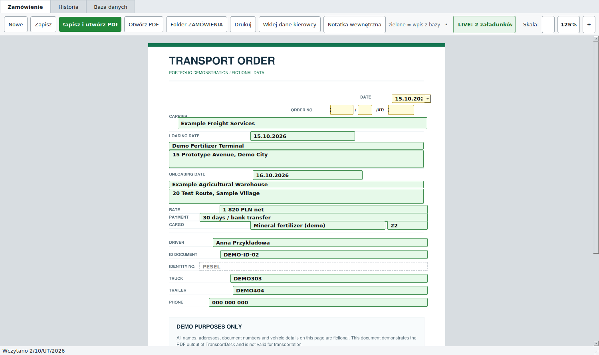
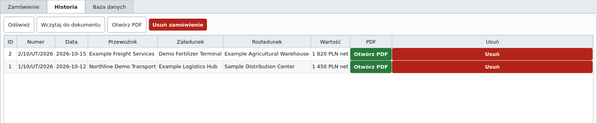
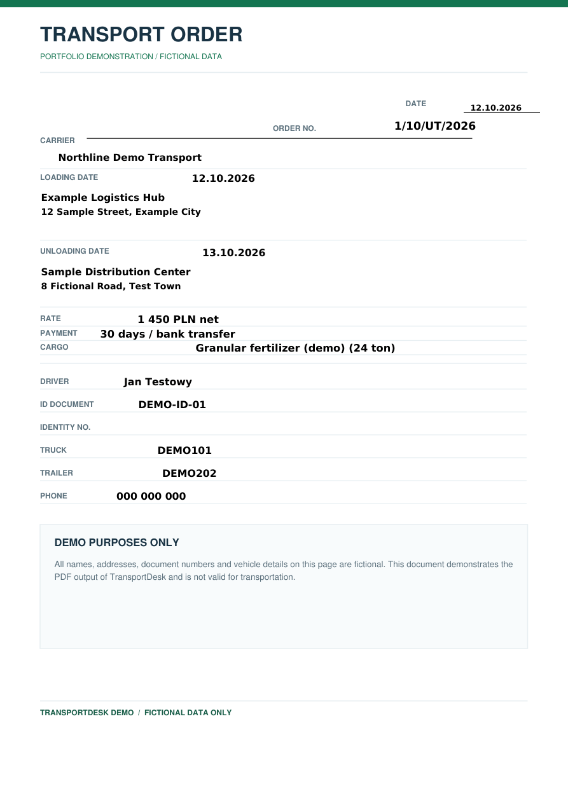

# TransportDesk — Transport Order Generator

A **Windows desktop application** I developed for a fertilizer distribution company to prepare, manage and print transport orders. The tool has been used in the company's daily workflow to reduce repetitive document entry and keep previous orders accessible.

The main idea is to **edit a transport order directly on top of a PDF preview** instead of filling out a separate form and hoping the printed document looks right.

**Python · PySide6 / Qt · SQLite · PyMuPDF · PyInstaller · GitHub Actions**

[**Download Windows demo**](https://github.com/MichalKostepski/transport-order-generator/releases/latest) · [Architecture](docs/ARCHITECTURE.md) · [Demo instructions](demo/README.md)

## See it in action

These are genuine screenshots of the PySide6 application running with a **neutral PDF template and two fictional transport orders**. The example is isolated from the company's database, documents and configuration.

### PDF-based editor



### Order history



### Generated transport order



[View the complete sample PDF](docs/sample-transport-order.pdf) · [60–90 second walkthrough](demo/RECORDING_GUIDE.md)

## Features

- **PDF-aligned editor:** renders a document template and places Qt input widgets over the corresponding PDF fields; supports zoom.
- **Reusable data:** autocomplete for carriers, drivers, loading locations and destinations. Choosing a saved location also fills its address.
- **Driver-message parser:** extracts names, identity-document details, phone numbers and vehicle registrations from pasted messages with recognizable Polish labels.
- **Order history:** stores orders in SQLite, reopens them for editing and regenerates missing PDFs.
- **Editable dictionaries:** manage previously used drivers, carriers and locations without maintaining separate spreadsheets.
- **PDF creation and printing:** generates documents from a template and organizes output under year/month folders.

## What was interesting to build?

**1. An editor positioned over a PDF.** PyMuPDF renders the source template, while Qt widgets are aligned to PDF coordinates. Scaling the view means scaling the fields too. Generated PDFs use corresponding positions, so changing a template requires reviewing both the preview and the export coordinates.

**2. Autocomplete that does not overwrite user input.** Suggestions combine dictionary data with historical orders. Location matching ranks exact names, prefixes and partial matches. The user must explicitly choose a result before the program fills the associated address.

**3. Parsing inconsistent messages.** The driver parser uses regular expressions and Polish field labels to turn pasted text into editable form fields. It handles common patterns without an API or AI service, but it deliberately allows manual correction when a message is unusual.

**4. Separating business data from generated documents.** SQLite stores order details and reusable records; PDF files are saved separately. Reopening an old order can regenerate the document if its PDF is missing.

**5. Packaging a genuine demo.** A separate demo launcher creates two fictional orders under the current user's local application-data folder. GitHub Actions checks this isolation, tests parsing and PDF creation, and builds a portable Windows executable. The packaged EXE also goes through a headless Qt startup test.

## Try it on Windows — no Python installation

1. Sign in to GitHub and open the [latest TransportDesk release](https://github.com/MichalKostepski/transport-order-generator/releases/latest).
2. Download **`TransportDeskDemo-Windows-x64.zip`** from **Assets**.
3. Extract the whole archive, open the `TransportDeskDemo` folder and double-click **`TransportDeskDemo.exe`**.
4. Open **Historia**, select one of the two fictional orders, and try editing or generating a PDF.

The `_internal` folder must stay next to the executable. You do **not** need Python, Docker, a SQL Server instance or any company files.

The demo saves only its own files in `%LOCALAPPDATA%\TransportDeskDemo`. More detail: [demo instructions](demo/README.md).

## Run the code locally

For development, install Python 3 and run the isolated demo from the repository root:

```powershell
.\DEMO_START.bat
```

The launcher creates a virtual environment and installs dependencies on first use. Unlike the ordinary `run.py` entry point, it never reads the regular application's `config.json`.

If you specifically want to run the non-demo application, copy `config.example.json` to `config.json`, review its settings and launch `py -3 run.py` against your own data.

## Tests and CI

```powershell
py -3 demo/test_demo.py
py -3 narzedzia/test_parser.py
py -3 narzedzia/test_aplikacji.py
```

The test suite covers SQLite initialization, non-duplicating sample data, location lookup, text parsing, PDF generation and reset isolation.

- [Demo smoke tests](.github/workflows/demo-smoke-tests.yml) run on Windows and Ubuntu and generate Qt UI captures for visual review.
- [Windows portable build](.github/workflows/windows-portable-demo.yml) builds with PyInstaller, starts the **packaged** application in a headless Qt test, and publishes a downloadable ZIP through GitHub Releases.

These checks are useful, but they do **not** replace manually testing printing, antivirus/SmartScreen behavior and layout on the actual laptop. Use the [Windows demo QA checklist](docs/MANUAL_QA.md) before a live presentation.

## Project layout

```text
app/main.py            PySide6 interface, PDF-aligned editor, history, dictionaries
app/database.py        SQLite persistence, optional SQL Server adapter
app/driver_parser.py   Regex-based extraction of driver and vehicle details
app/pdf_generator.py   PDF template rendering and document generation
demo/                   Fictional data, isolated launcher, screenshot and demo tests
assets/template.pdf     Neutral portfolio PDF template
.github/workflows/      Cross-platform tests and portable Windows release automation
docs/                   Architecture, CV notes and real demo screenshots
```

## Current limitations and privacy

- This is a **desktop Windows workflow**, not a hosted web app.
- The demo uses only fictional records and a neutral PDF template. It is not suitable for issuing actual transport orders.
- The optional SQL Server path is present in the code; this repository does not claim it has been deployed or validated in production.
- Real printers and all laptop resolutions have not been tested by CI.
- Business data, original company document templates, operational instructions and real drivers' personal data are deliberately excluded.

This repository remains **private**. Sharing company-related software publicly requires a separate review of publication rights and the entire Git history.

[Architecture and trade-offs](docs/ARCHITECTURE.md) · [Portfolio/CV summary](docs/PORTFOLIO_CV.md)
